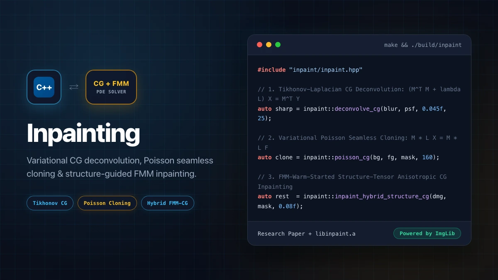
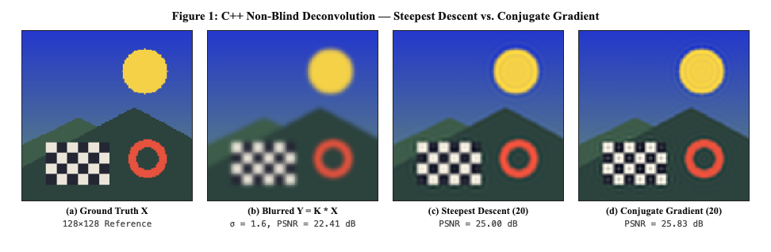
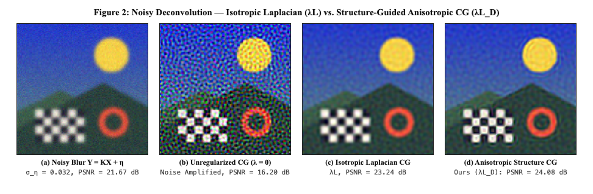
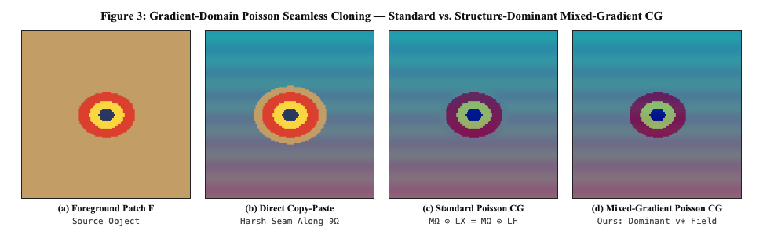
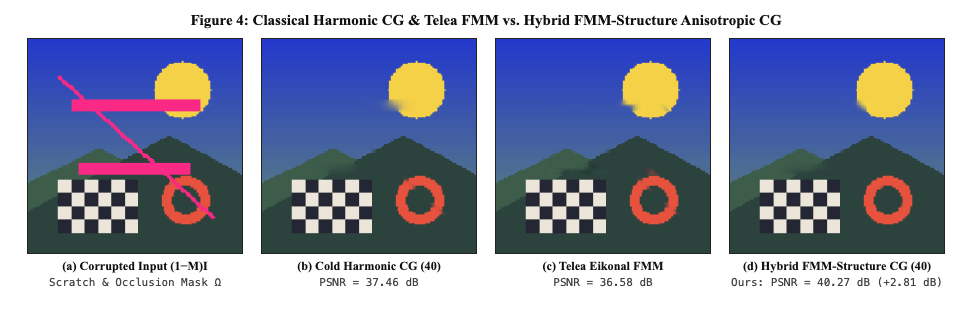

[](https://github.com/mk314k/inpainting/actions/workflows/makefile.yml)


# Inpainting & Variational Image Restoration

**Inpainting** is a C++17 variational inverse-problems library and research monograph built on top of [`ImgLib`](https://github.com/mk314k/ImgLib) (`namespace inpaint`), implementing matrix-free **Conjugate Gradient Deconvolution**, **Variational Poisson Seamless Cloning**, **Telea's Eikonal Fast Marching Method (FMM)**, and a hybrid **FMM-Warm-Started Structure-Tensor Anisotropic CG Inpainting** solver.

- **Research Paper (PDF & LaTeX)**: [`research/paper.pdf`](research/paper.pdf) &middot; [`research/paper.tex`](research/paper.tex) (*"Variational Image Restoration: Deconvolution, Poisson Editing, and Structure-Guided Inpainting"*)



---

## Mathematical & Algorithmic Overview

1. **Discrete Differential Operators & Adjoint Convolution (`include/inpaint/operators.hpp`)**:
   - Matrix-free forward convolution $M_K X = K * X$ and exact adjoint convolution $M_K^T Y = K^* * Y$ via kernel reflection.
   - Five-point discrete negative Laplacian $L = G^T G = \nabla_x^T \nabla_x + \nabla_y^T \nabla_y$ and spatially varying structure-tensor anisotropic divergence operator $L_D = G^T D(x,y) G$.
2. **Non-Blind Deconvolution (`include/inpaint/deconv.hpp`)**:
   - Exact line-search **Steepest Descent** (`deconvolve_steepest_descent`) and **Tikhonov–Laplacian Regularized Conjugate Gradient** (`deconvolve_cg`) solving $(M^T M + \lambda L)X = M^T Y$.
3. **Variational Poisson Seamless Cloning (`include/inpaint/poisson.hpp`)**:
   - Solves the masked Dirichlet boundary-value problem $M_\Omega \odot (L X) = M_\Omega \odot (L F)$ with $(1 - M_\Omega)\odot X = (1 - M_\Omega)\odot B$ via Steepest Descent (`poisson_steepest_descent`) and Masked Conjugate Gradient (`poisson_cg`).
4. **Digital Image Inpainting (`include/inpaint/inpaint.hpp`)**:
   - **Harmonic PDE Inpainting (`inpaint_harmonic_cg`)**: Solves the discrete Laplace equation $M_\Omega \odot (L X) = 0$.
   - **Telea Eikonal Fast Marching Method (`inpaint_telea_fmm`)**: Single-pass $\mathcal{O}(|\Omega|\log|\Omega|)$ narrow-band min-heap solver for the upwind Eikonal equation $|\nabla T| = 1$ with directional first-order Taylor interpolation.
   - **FMM-Warm-Started Structure-Tensor Anisotropic CG (`inpaint_hybrid_structure_cg`)**: Uses Telea's FMM solution $X_{\text{FMM}}$ to warm-start Conjugate Gradient on the structure-tensor-guided anisotropic PDE $M_\Omega \odot (G^T D G X) = 0$, eliminating cold-start boundary lag and FMM medial-axis seams while preserving cross-boundary edges.

---

## Experimental Benchmarks









---

## Quickstart

```bash
git clone --recursive https://github.com/mk314k/inpainting.git
cd inpainting
make          # builds build/libinpaint.a and build/inpaint CLI
make check    # runs unit test suite (4/4 suites passing)
```

### CLI Commands

```bash
./build/inpaint benchmark ./output_dir
./build/inpaint deconv    blurred.png sharp.png 1.6 0.045 25
./build/inpaint poisson   bg.png fg.png mask.png cloned.png 160
./build/inpaint harmonic  damaged.png mask.png harmonic.png 160
./build/inpaint fmm       damaged.png mask.png fmm.png 3
./build/inpaint hybrid    damaged.png mask.png hybrid.png 60
```

## License

Licensed under the [MIT License](LICENSE).
